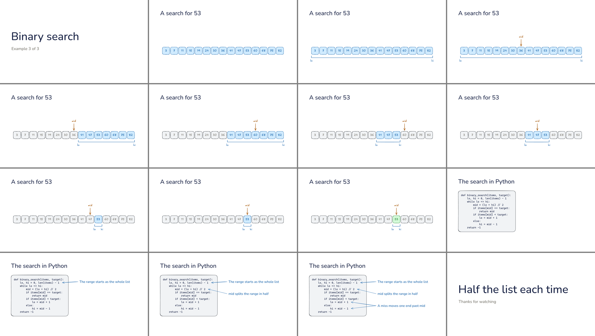
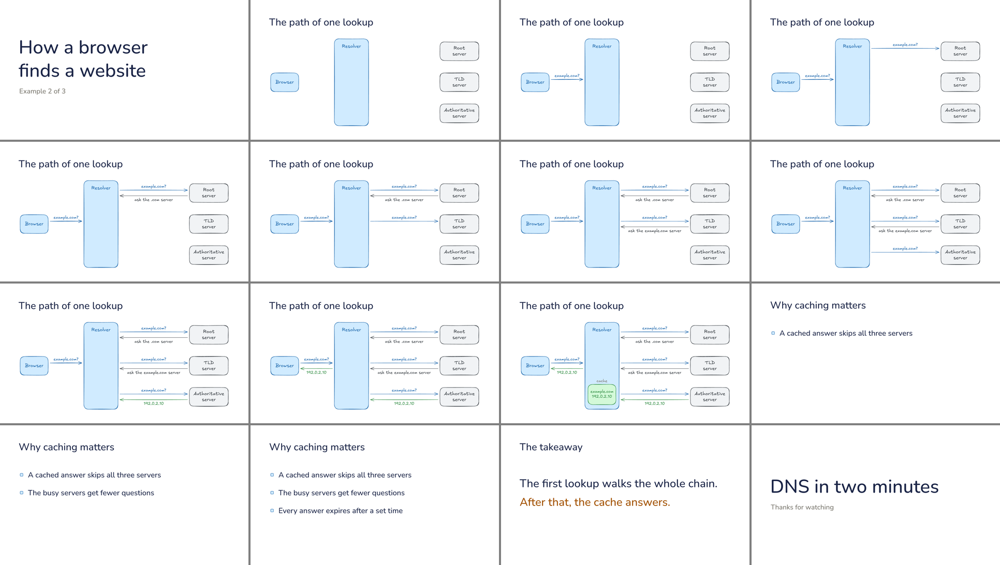
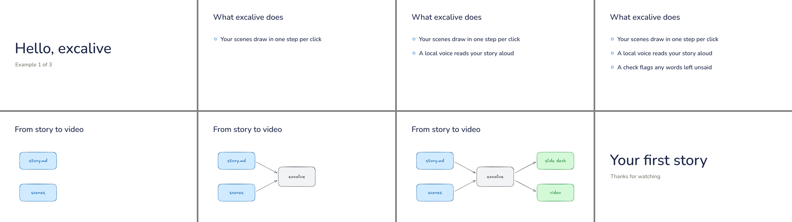

# excalive

Hand-drawn slide decks and narrated videos from one markdown file.

You draw scenes in [Excalidraw](https://excalidraw.com) and list each
scene's build steps. You write a story: one markdown section per step,
holding what is said while that step is on screen. excalive turns the
story into a Slidev deck with a still per click, or into a video where a
local voice ([Kokoro](https://github.com/hexgrad/kokoro)) reads each
section while its step draws in. Before it renders anything, it checks
that every word on screen is said, that nothing runs off the page, and
that the narration will not trip the voice.

## Examples

Each example is one `story.md` that builds both a slide deck and a
narrated video. The animations below are the diagrams drawing in step by
step; the videos add the voice.

### Binary search

A search for 53 in fifteen sorted numbers. `lo`, `hi` and `mid` slide to
their new boxes, the ruled-out half turns gray, and the answer turns
green. Each step after the first three names its own scene file, and
elements that share an id move into place. A code card with notes
follows.

    ## search 2
    mid is the box halfway between them. It holds 36.

    ## search 3
    36 is less than 53, so everything up to mid turns gray, and lo moves just past it.

[Watch the video (1:30)](examples/binary-search/binary-search.mp4) ·
[story.md](examples/binary-search/story.md) ·
[scenes](examples/binary-search/scenes)

Every slide

### How a browser finds a website

A diagram explainer: one arrow per step as the resolver asks the root,
TLD and authoritative servers, then caches the answer. Each color means
one thing: blue asks, gray refers, green is the address. A list on why
caching matters and a one-line takeaway follow.

    ## lookup 2
    The resolver starts at the top. It asks a root server: example.com?

    ## lookup 3
    The root server does not know, but it knows who runs dot com. Ask the dot com server.

[Watch the video (2:01)](examples/dns/dns.mp4) ·
[story.md](examples/dns/story.md) ·
[scenes](examples/dns/scenes)

Every slide

### Hello

The smallest complete story, and the one to copy when you start your
own: a title card, a list that builds one item per click, this
three-step diagram, and an end card.

[Watch the video (0:45)](examples/hello/hello.mp4) ·
[story.md](examples/hello/story.md) ·
[scenes](examples/hello/scenes)

Every slide

Build any of them yourself:

    excalive check  examples/hello/story.md
    excalive slides examples/hello/story.md
    excalive video  examples/hello/story.md

## Install

Needs `node`, `ffmpeg`, [`uv`](https://docs.astral.sh/uv/), and
[`mcp-excalidraw-server`](https://github.com/yctimlin/mcp_excalidraw) 2.1
or later, whose headless renderer draws every frame. Slidev is only
needed to export a deck to PDF or PPTX.

The repository is a Claude Code skill. Clone it into your skills folder
and you get both: Claude Code reads `SKILL.md`, which tells the agent how
to draw scenes, write the story and run the checks, and the command it
runs is `bin/excalive` in the same folder.

    git clone https://github.com/RafeSymonds/excalive ~/.claude/skills/excalive

For one project only, clone it into that project's
`.claude/skills/excalive` instead. To update, `git pull` in the clone.

Without Claude Code, clone it anywhere and run `bin/excalive`:

    git clone https://github.com/RafeSymonds/excalive
    excalive/bin/excalive check excalive/examples/hello/story.md

Then fetch the renderer once with `npx -y mcp-excalidraw-server status`.
The first `video` run downloads Kokoro and its weights through uv, about
330 MB. Nothing is installed system-wide. Put `bin/` on your PATH if you
want to type `excalive` instead of its path.

## How a story works

This is the start of [`examples/hello/story.md`](examples/hello/story.md):

    ---
    scenes: [scenes]                   # searched in order for <scene>.excalidraw
    lexicon: [lexicon.json]            # pronunciations
    video: out/hello.mp4
    work: out/work                     # voice cache, storyboards, contact sheets
    slides: {file: out/slides.md, images: out/img}
    ---

    ## title-card 0 | Hello, excalive
    This is example 1 of 3, the smallest story excalive can build.

    ## what 1 | What excalive does
    Your scenes draw in one step per click.

    ## what 2
    A local voice reads your story aloud, on your own machine.

A heading is `## <scene> <step> | <slide title>`, with the title on a
scene's first section. In a deck the text under it becomes the presenter
notes. In a video it is what the voice says while that step is on
screen, and the step holds until the sentence ends, so the picture
cannot drift from the voice.

A scene is `<scene>.excalidraw`, and its build steps are in the
`steps.json` beside it, one entry per click:

    {"what":   [["frame", "title"],
                ["frame", "title", "m0", "i0"],
                ["frame", "title", "m0", "i0", "m1", "i1"]],
     "search": [["frame", "b0", "bn0", "..."], "search-3", "search-4"]}

A step that lists ids shows those elements of the scene. A step that
names another scene file (`"search-3"`) shows that file instead, and
every element that shares an id with the step before slides, resizes or
recolors into place. New elements draw in: arrows grow along their path,
shapes draw their outline and fill, text fades in. Removed ones fade out.

Other front matter: `voice` and `speed` (Kokoro), `silent` (on-screen
text the words need not say, per scene), `title` (size, color and font of
the titles drawn above diagrams, Nunito by default), `text_x`, `intro`, `end_hold`, `gap`.
`scripts/story.py` opens with the full list.

## Commands

    excalive check   story.md      every check, in about a second; no render
    excalive slides  story.md      a still per click, a Slidev deck, contact sheets
    excalive video   story.md      voice every section, then draw the video
    excalive animate [args]        the renderer alone: files, steps, snapshots, storyboards
    excalive measure --size 48 "text"   the drawn width of a line of text
    excalive usage   [paths]       tokens, time and cost of Claude Code transcripts

`check` reports:

- **Unspoken text.** Every on-screen line whose content words the section
  never says. Viewers read along while they listen, so a label the voice
  skips reads as the two disagreeing. A video refuses to render until
  this is clean.
- **Overflow.** Card text that runs past the margin or the bottom of the
  page, and diagram text outside its frame, measured with the fonts the
  frames are drawn with.
- **Speech.** Text a voice misreads: "Sep 11", "1M", "1214" read as a
  year, a version like "K2.5", an initialism with a hyphen.
- **Structure.** Missing scenes and steps, and a slide title used twice.

`slides` takes seconds. `video` voices only the sections whose words
changed, then draws the whole video in one pass: a 16-minute video takes
about three and a half minutes on an M-series Mac.

## With a coding agent

The skill gives an agent the whole loop: draw, write, check,
build, look at the contact sheets. [`docs/workflow.md`](docs/workflow.md)
says how to hand a batch of decks to agents one at a time, and what goes
wrong when you do not. `excalive usage` measures what a run cost from
its transcripts.

## Docs

- [`docs/style.md`](docs/style.md): the house style. Page geometry,
  fonts, colors, the kinds of slide with their JSON, measuring, diagrams,
  writing titles and list items, and the rules for a narrated video.
- [`docs/workflow.md`](docs/workflow.md): a deck and its video, step by
  step, and how to run agents on it.
- [`SKILL.md`](SKILL.md): the skill Claude Code loads.
- `scripts/story.py` and `scripts/animate.mjs` open with their full
  reference: every front matter key and every storyboard field.

## Layout

| Path | What |
|---|---|
| `bin/excalive` | The command |
| `scripts/story.py` | Stories: checks, voices, slides, the storyboard (a uv script) |
| `scripts/animate.mjs` | The renderer: keyframes to frames, frames to video, the checks |
| `scripts/usage.py` | Transcript costs |
| `assets/fonts/` | Nunito, which the headless renderer lacks |
| `SKILL.md` | The Claude Code skill |
| `examples/` | Three stories with their scenes |
| `docs/` | Style and workflow |

## Credits

The renderer is mcp-excalidraw-server's (MIT), loaded at run time. Voices
are Kokoro's (Apache 2.0), phonemized by misaki. Nunito is under the SIL
Open Font License, in [`assets/fonts/OFL.txt`](assets/fonts/OFL.txt).
excalive itself is MIT.
